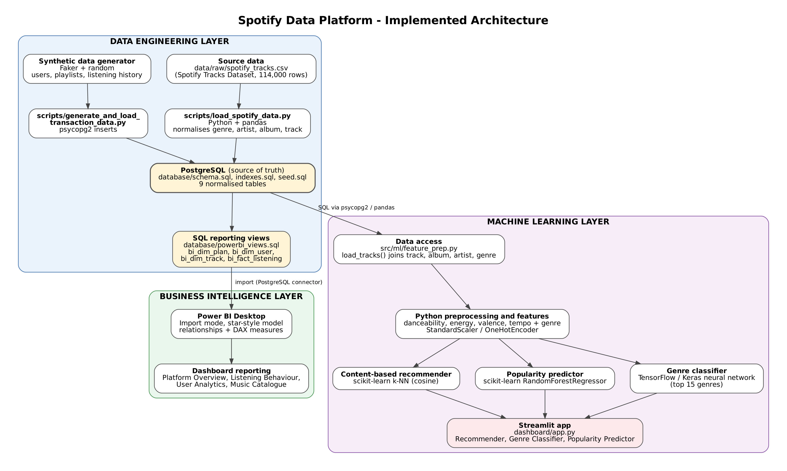
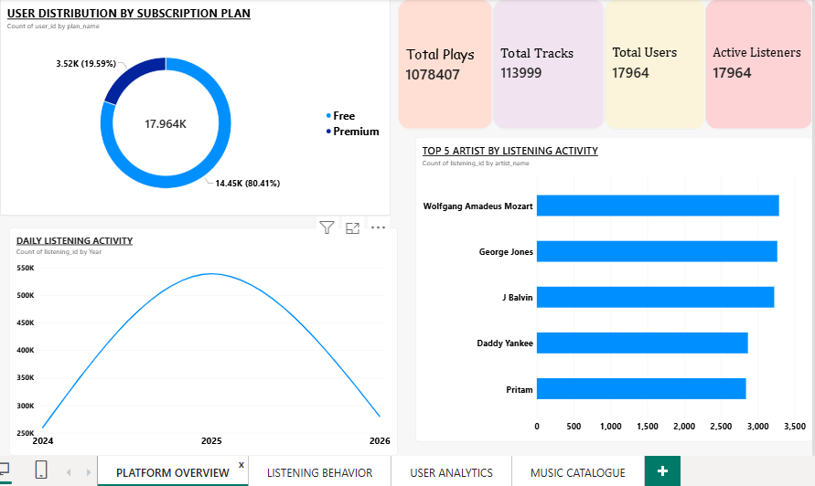
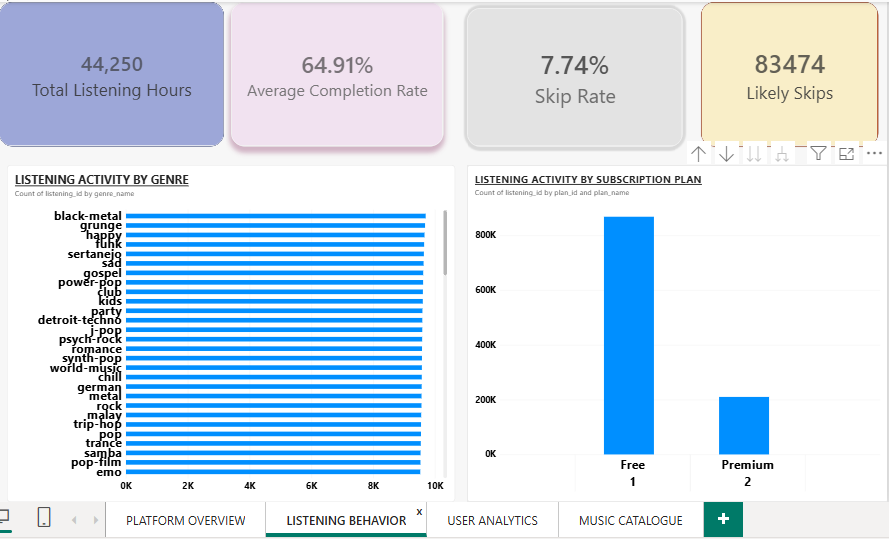
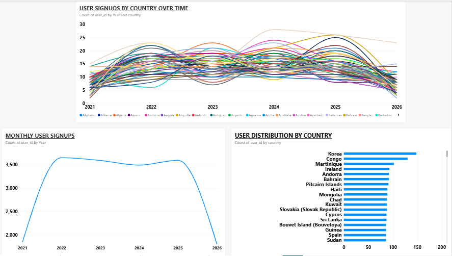
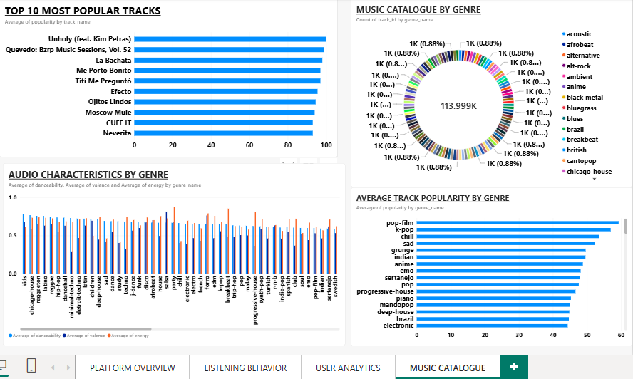

# Spotify Data Platform

**An end-to-end data engineering, analytics and machine learning system** built on PostgreSQL, Python, Power BI and Streamlit.

A Python ETL pipeline loads a real public Spotify tracks dataset into a normalised PostgreSQL database and adds a synthetic users/playlists/listening-history layer.
PostgreSQL then feeds two independent consumers: SQL reporting views that power a Power BI dashboard, and a machine-learning layer served through a Streamlit app.

## Why this project
A portfolio project to practise the full data lifecycle in one place: schema design, ETL, a BI semantic layer, dashboarding, and ML — with business analytics and machine learning deliberately kept separate.
Listening and user data are **simulated**; the track catalogue is real.

## Architecture


| Layer | Flow |
|---|---|
| Data Engineering | CSV + Faker → Python loaders → PostgreSQL → SQL reporting views |
| Business Intelligence | `bi_*` views → Power BI (import mode) → 4 dashboard pages |
| Machine Learning | PostgreSQL → Python feature prep → scikit-learn / Keras models → Streamlit |

More: [architecture](docs/architecture.md)

## Tech stack
| Area | Tools |
|---|---|
| Language / data | Python, pandas, NumPy, Faker |
| Database | PostgreSQL, SQL (schema, indexes, views), psycopg2 |
| BI | Power BI Desktop, DAX |
| ML | scikit-learn (k-NN, RandomForest), TensorFlow/Keras (genre classifier), joblib |
| App | Streamlit |

## Features
- **Data engineering:** 9-table normalised schema with constraints and indexes; catalogue loader (114,000-row CSV → genre/artist/album/track); synthetic data generator; four `bi_*` reporting views. → [ETL](docs/etl_pipeline.md) · [database design](docs/database_design.md)
- **Power BI:** four-page report on a one-fact/three-dimension model, KPI cards, DAX measures, Top N and sorted charts. → [POWER_BI_DOCUMENTATION.md](docs/POWER_BI_DOCUMENTATION.md)
- **Machine learning:** content-based track recommender, popularity predictor, genre classifier. → [ML docs](docs/machine_learning.md)
- **Streamlit app:** three interactive tools over the trained models.

## Power BI dashboards
| | |
|---|---|
|  |  |
|  |  |

*Pages: Platform Overview · Listening Behaviour · User Analytics · Music Catalogue. Report file: `powerbi/spotify_analytics.pbix` (add your latest copy, see `powerbi/README.md`) (import mode; data refresh currently blocked by an unresolved cyclic-reference error).*

## Repository structure
```
├── dashboard/app.py          Streamlit ML app
├── data/raw/                 Spotify tracks CSV
├── data/processed/           Saved outputs of an earlier analytics module (not used by the dashboards)
├── database/                 schema, seed, indexes, powerbi_views
├── docs/                     architecture, database, ETL, ML, setup, images
├── powerbi/                  Power BI report (.pbix)
├── scripts/                  ETL: catalogue loader, synthetic data generator
├── src/config/               database connection
├── src/ml/                   feature prep, popularity model, genre classifier, artifacts
├── src/recommender/          content-based recommender
├── tests/                    unit tests
├── requirements.txt
├── pyproject.toml
└── license
```

## Quick start
```bash
pip install -r requirements.txt
cp .env.example .env                       # add your PostgreSQL credentials
psql -d <db> -f database/schema.sql && psql -d <db> -f database/seed.sql
python -m scripts.load_spotify_data
python -m scripts.generate_and_load_transaction_data
psql -d <db> -f database/indexes.sql && psql -d <db> -f database/powerbi_views.sql
streamlit run dashboard/app.py
```
Full instructions, training commands and troubleshooting: [docs/setup_guide.md](docs/setup_guide.md). Tests: `python -m unittest discover -s tests -t . -v`.

## Documentation
| Document | Content |
|---|---|
| [POWER_BI_DOCUMENTATION.md](docs/POWER_BI_DOCUMENTATION.md) | Reporting views, data model, measures, pages, limitations |
| [docs/README.md](docs/README.md) | Index of all documentation |
| [docs/architecture.md](docs/architecture.md) | Layers and design decisions |
| [docs/database_design.md](docs/database_design.md) | ERD, tables, constraints |
| [docs/etl_pipeline.md](docs/etl_pipeline.md) · [docs/data_mapping.md](docs/data_mapping.md) | Ingestion and column mapping |
| [docs/machine_learning.md](docs/machine_learning.md) | Models and Streamlit app |
| [docs/setup_guide.md](docs/setup_guide.md) | Setup and execution |
| [docs/business_requirements.md](docs/business_requirements.md) · [docs/engineering_principles.md](docs/engineering_principles.md) | Requirements and engineering principles |
| [docs/portfolio_description.md](docs/portfolio_description.md) | CV / portfolio text |

## Known limitations
- Users, playlists and listening history are synthetic; analytics describe a simulated platform.
- The Power BI report is an imported snapshot and cannot currently be refreshed (cyclic reference error).
- The Streamlit app needs TensorFlow, a running PostgreSQL database and the saved model artifacts.
- The schema stores four audio features; the dataset has more (see [data_mapping.md](docs/data_mapping.md)).
- `data/processed/*.csv` come from an analytics module that is not in the repository. Some of their play counts look inflated by a join between playlists and listening history, so they should not be cited.

## License
MIT (see [`license`](license)). The Spotify tracks dataset in `data/raw/` is third-party and not covered by this licence.
