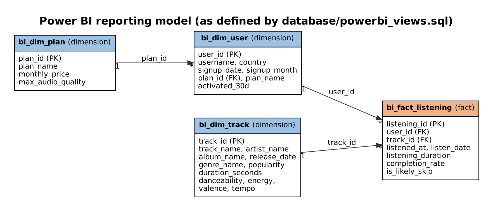
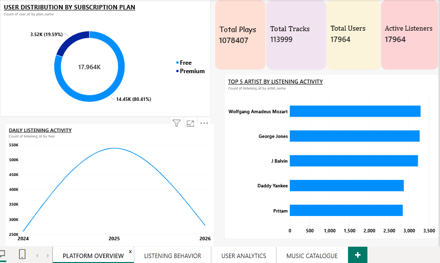
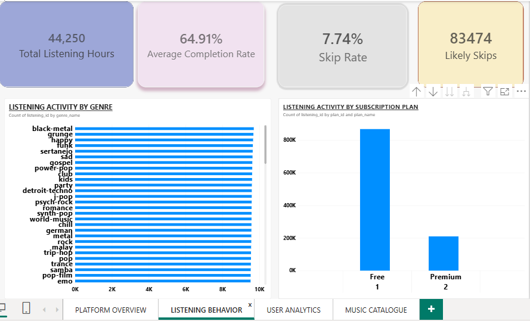
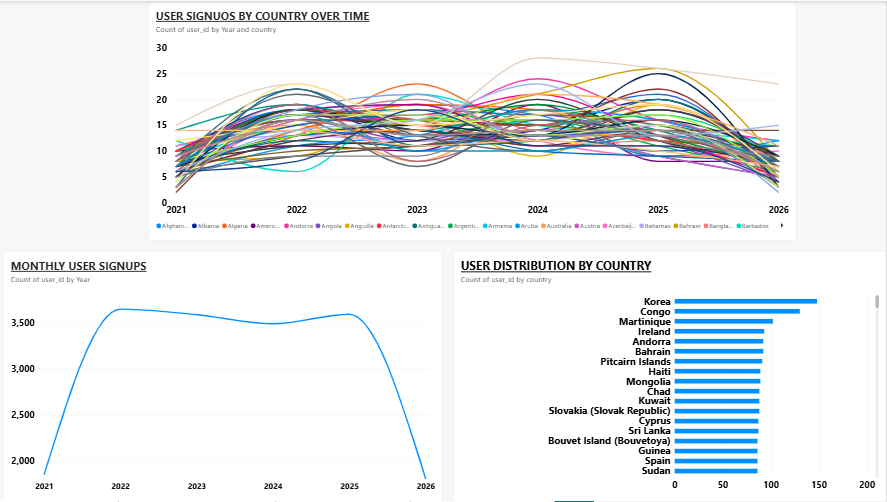
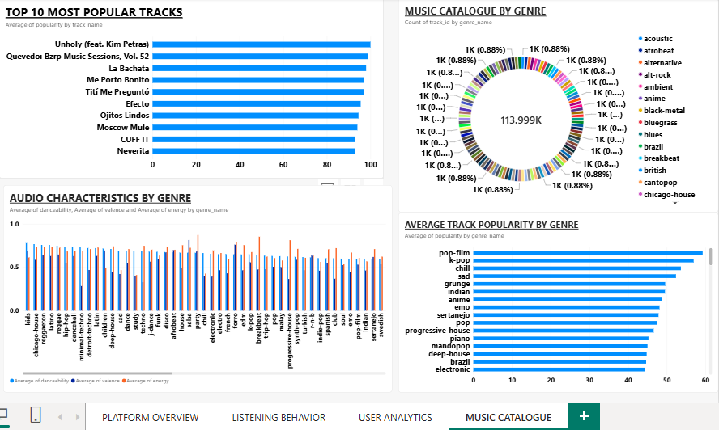

# Power BI Documentation

This page explains the Power BI report in the Spotify Data Platform: where its data comes from, how the data model is built, what each dashboard page shows, and what to keep in mind when reading it.

> **How to read the notes on this page.** The DAX formulas, chart fields and numbers on this page come from the DAX and the four dashboard screenshots you supplied (confirmed). Relationships, one-to-many filtering and import mode come from your project brief and could not be checked, because the `.pbix` file I received is an older save with only the KPI cards (your description).

---

## 1. What the report is for

The report is the business-intelligence part of the project. It lets someone with no SQL knowledge explore the platform's activity on four pages:

| Page | Questions it answers |
|---|---|
| **Platform Overview** | How big is the platform? How does daily listening change? Which artists are played most? How are users split across plans? |
| **Listening Behaviour** | How many hours are listened to? How much of each track do people play? How many plays look like skips? Which genres and plans listen most? |
| **User Analytics** | Where are the users? How fast is the user base growing, overall and by country? |
| **Music Catalogue** | Which tracks are most popular? How is the catalogue split by genre? What does each genre sound like (danceability, energy, valence)? |

The machine-learning tools are not in Power BI. They live in the [Streamlit app](machine_learning.md).

## 2. Where the data comes from

Everything starts in **PostgreSQL**, the project's main database. The database stores data in nine tables designed for storing and loading ([database design](database_design.md)). That layout is awkward for reporting, so Power BI does not read those tables directly. It reads four **SQL views**, which are saved queries that present the data in a simpler shape (defined in [`database/powerbi_views.sql`](../database/powerbi_views.sql), confirmed):

| View | One row per... | What it gives Power BI |
|---|---|---|
| `bi_fact_listening` | listen | When it happened, how long it lasted, how much of the track was heard (`completion_rate`), and whether it was a likely skip (`is_likely_skip`) |
| `bi_dim_user` | user | Country, signup date and month, plan name, and whether the user listened within 30 days of signing up |
| `bi_dim_track` | track | Track, artist, album and genre names, popularity, length, and audio features |
| `bi_dim_plan` | plan | Plan name, price and audio quality |

**Why use views?**
- The joins and rules (for example "a listen under 35% of the track is a likely skip") are written once, in SQL, instead of being hidden inside the report.
- The report is protected from changes to the underlying tables. If the tables change, only the views need updating.
- Power BI only sees clean, flat tables with readable column names.

## 3. The data model

The model has one **fact table** and three **dimension tables**:

- A *fact table* records events and holds the numbers you add up. Here it is `bi_fact_listening`, with about 1.08 million rows, one per listen (your description).
- *Dimension tables* describe the things the events refer to, and are what you filter and group by. Here these are users, tracks and plans.

**Relationships** (keys confirmed from the views, relationship settings from your description):

| One side | Many side | Joined on |
|---|---|---|
| `bi_dim_plan` | `bi_dim_user` | `plan_id` |
| `bi_dim_user` | `bi_fact_listening` | `user_id` |
| `bi_dim_track` | `bi_fact_listening` | `track_id` |

Because plan connects to users rather than directly to the fact table, this is a "star-schema-style" model rather than a perfect star.

**Why one-to-many?** One plan has many users, one user has many listens, and one track appears in many listens. Each dimension row is unique, so every listen matches exactly one user and one track and nothing is counted twice.

**How filtering flows.** Filters travel from the "one" side to the "many" side, in one direction only. Picking a plan narrows the users, which narrows the listens, so every plan-based chart updates. Picking a genre or artist narrows the listens the same way. A filter on listens never flows back to users or tracks, which keeps the model free of ambiguous paths.

## 4. DAX measures

A *measure* is a calculation written in DAX (Power BI's formula language). It is recalculated every time you filter the report. The report uses eight, all taken from the DAX you supplied (confirmed).

| Measure | Table | Formula | What it does |
|---|---|---|---|
| **Total Plays** | `bi_fact_listening` | `COUNTROWS('bi_fact_listening')` | Counts the rows in the listening table, so it counts every listen. |
| **Total Users** | `bi_dim_user` | `DISTINCTCOUNT('bi_dim_user'[user_id])` | Counts each user once. |
| **Total Tracks** | `bi_dim_track` | `DISTINCTCOUNT('bi_dim_track'[track_id])` | Counts each track once. |
| **Active Listeners** | `bi_fact_listening` | `DISTINCTCOUNT('bi_fact_listening'[user_id])` | Counts each user who has at least one listen, however many they have. |
| **Average Completion Rate** | `bi_fact_listening` | `AVERAGE('bi_fact_listening'[completion_rate])` | Averages the share of each track that was played (1 means the whole track). |
| **Likely Skips** | `bi_fact_listening` | `SUM('bi_fact_listening'[is_likely_skip])` | Adds up the skip flag. The view sets it to 1 when under 35% of a track was heard, so the sum is the number of likely skips. |
| **Skip Rate** | `bi_fact_listening` | `DIVIDE([Likely Skips], [Total Plays])` | Likely skips divided by total plays. `DIVIDE` returns blank instead of an error when there are no plays. |
| **Total Listening Hours** | `bi_fact_listening` | `DIVIDE(SUM('bi_fact_listening'[listening_duration]), 3600)` | Adds up listening time in seconds and divides by 3,600 to get hours. |

**What this tells us**

- **Total Users vs Active Listeners.** Total Users counts everyone in the user table. Active Listeners counts only those who listened. If the two differ, some users never played anything.
- **Filters reach some cards and not others.** Filters flow from dimension to fact (see section 3). So picking a genre changes Total Plays and Active Listeners, but Total Users and Total Tracks do not respond to it, because their tables sit upstream of the listening table. That is expected behaviour, not a bug.
- **Measures built on measures.** Skip Rate reuses Likely Skips and Total Plays, so the rate always matches the two numbers shown beside it.
- **Aggregation types.** Between them the measures use `COUNTROWS`, `DISTINCTCOUNT`, `SUM`, `AVERAGE` and `DIVIDE`, matching the aggregations listed in your project brief.

## 5. The four dashboard pages

Each page is shown as a screenshot, followed by what its visuals use and show. The "Fields" column is read from the small subtitle under each chart title in the report.

### Page 1: Platform Overview

| Visual | Type | Fields | What it shows | Why this chart type |
|---|---|---|---|---|
| Total Plays, Total Tracks, Total Users, Active Listeners | KPI cards | the four measures | One headline number each | A single number is clearest as a card |
| Daily Listening Activity | Line chart | count of `listening_id` by Year | Plays per year | Lines show change over time |
| Top 5 Artist by Listening Activity | Clustered bar | count of `listening_id` by `artist_name`, Top 5 | The five most-played artists | Horizontal bars suit ranked names; Top N keeps it short |
| User Distribution by Subscription Plan | Donut | count of `user_id` by `plan_name` | Share of users per plan | A donut shows parts of a whole, and there are only two plans |

### Page 2: Listening Behaviour

| Visual | Type | Fields | What it shows | Why this chart type |
|---|---|---|---|---|
| Total Listening Hours, Average Completion Rate, Skip Rate, Likely Skips | KPI cards | the four measures | One headline number each | Cards for single values |
| Listening Activity by Genre | Clustered bar | count of `listening_id` by `genre_name` | Plays per genre | Bars compare many categories |
| Listening Activity by Subscription Plan | Clustered column | count of `listening_id` by `plan_id` and `plan_name` | Plays per plan | Columns compare a few categories side by side |

### Page 3: User Analytics

| Visual | Type | Fields | What it shows | Why this chart type |
|---|---|---|---|---|
| User Distribution by Country | Clustered bar | count of `user_id` by `country` | Users per country | Bars handle long country names better than a pie |
| Monthly User Signups | Line chart | count of `user_id` by Year | New users per year | Lines show growth over time |
| User Signups by Country Over Time | Line chart | count of `user_id` by Year and `country` | One line per country | Several lines compare trends, but only when few are shown |

### Page 4: Music Catalogue

| Visual | Type | Fields | What it shows | Why this chart type |
|---|---|---|---|---|
| Top 10 Most Popular Tracks | Clustered bar | average of `popularity` by `track_name`, Top 10 | The ten tracks with the highest popularity score | Ranked bars with Top N |
| Music Catalogue by Genre | Donut | count of `track_id` by `genre_name` | Each genre's share of tracks | Shows parts of a whole (hard to read with 114 slices) |
| Audio Characteristics by Genre | Clustered column | average of `danceability`, `valence` and `energy` by `genre_name` | Audio profile of each genre | Three scores side by side give each genre a profile |
| Average Track Popularity by Genre | Clustered bar | average of `popularity` by `genre_name` | Which genres have more popular tracks | An average stops genres with more tracks from winning by size |

## 6. Power BI features used

| Feature | How it is used |
|---|---|
| **KPI cards** | Eight cards, four on Platform Overview and four on Listening Behaviour (confirmed) |
| **DAX measures** | Eight measures, with formulas in section 4 (confirmed) |
| **Aggregations** | Row count, distinct count, sum, average and safe division in the measures; count, sum and average of view columns in the charts (confirmed) |
| **Top N filters** | Top 5 artists and Top 10 tracks (confirmed from the visuals) |
| **Sorting** | Bars are sorted with the largest value first (confirmed) |
| **Relationships** | One-to-many, one direction (your description) |
| **Import mode** | Data is copied into the `.pbix`, so the report opens quickly with no database connection, but only shows data as of the last load (your description) |
| **Interactive filtering** | Selecting a visual can filter the others; the report settings allow this (confirmed). The screenshots show no slicers |
| **Theme and layout** | Power BI's built-in Fluent 2 theme; colour-coded KPI cards (confirmed) |

## 7. Key insights

These are read straight from the screenshots. The first list is what the dashboards show. The second list is possible explanations, and these are not proven.

### What the dashboards show
- **Size.** 1,078,407 plays from 17,964 users and 113,999 tracks. That is about 60 plays per user.
- **Every user is active.** Active Listeners equals Total Users (17,964), so every user has at least one listen.
- **Plans.** 80.41% of users are on Free (14.45K) and 19.59% on Premium (3.52K). Free users also have far more plays: about 865K against about 210K for Premium (read from the chart).
- **Listening time.** 44,250 hours in total, which works out at about 2.5 minutes per play.
- **Completion and skips.** The average completion rate is 64.91%. 83,474 plays (7.74%) are likely skips.
- **Plays over time.** About 260K plays in 2024, about 540K in 2025 and about 280K in 2026.
- **Genres are almost equal.** Each of the 114 genres has about 9.5K plays and exactly 1K tracks (0.88% of the catalogue each).
- **Signups.** Signups are about 3,500 to 3,650 per year from 2022 to 2025, with about 1,850 in 2021 and about 1,800 in 2026.
- **Countries.** Korea has the most users (about 150), then Congo (about 130) and Martinique (about 100). Most other countries sit around 85 to 90.
- **Top artists.** Wolfgang Amadeus Mozart (about 3,300 plays), George Jones (about 3,250), J Balvin (about 3,200), Daddy Yankee (about 2,900) and Pritam (about 2,850).
- **Popularity.** The most popular tracks all score between about 93 and 100, led by "Unholy (feat. Kim Petras)". By genre, pop-film (about 59) and k-pop (about 56) have the highest average popularity.

### Possible explanations (not proven)
- **The top artists are the artists with the most tracks.** In the raw dataset these five artists also have the most tracks (Mozart 354, J Balvin 347, George Jones 343, Daddy Yankee 314, Pritam 302). Since each listen picks a track at random, more tracks means more plays. So the ranking reflects catalogue size, not popularity.
- The 80/20 plan split, the flat genre bars and the 65% completion rate look like the result of how the data was generated: plans, tracks and listen lengths are chosen at random. Real listeners would not look this even. The generator's rules would give a completion rate near 65% and a skip rate of about 7%, which is close to what the dashboard shows.
- The low 2021 and 2026 signup numbers and the low 2024 and 2026 play counts probably come from partial years at the start and end of the data window, not from a real drop.
- Free having more plays than Premium comes from Free having about four times as many users. Dividing the chart values by the user counts gives roughly 60 plays per user on both plans, so the two plans listen about equally. This is a rough figure, because the chart values are read by eye.

## 8. Limitations

- **Simulated data.** Users, playlists and listens are generated. Only the track list is real. The report describes a simulated platform.
- **Imported snapshot.** The report shows data as of the last load and does not update when the database changes.
- **Refresh error.** Refreshing currently fails with a "cyclic reference" error. The report itself works, and I did not change the model, as you asked. The eight measures are not the cause: none of them refers back to itself. A cyclic reference usually comes from calculated columns, calculated tables or relationships that depend on each other, so those are the things to check next.
- **Skips are an estimate.** A "likely skip" means under 35% of a track was heard. There is no real skip event.
- **Listens can come before signup.** The generator picks listen dates and signup dates independently, which affects the 30-day activation flag in `bi_dim_user`.
- **Popularity is a snapshot** from the public dataset and has no link to the simulated listens.

## 9. Things to improve in the report

Three charts were fixed: the artist chart and the plan chart now count listens instead of adding up `listening_id` numbers, and the audio chart now shows averages (axis 0 to 1). The remaining items affect readability only, not the numbers:

| Chart | What is wrong | Suggested fix |
|---|---|---|
| Daily Listening Activity | Titled "daily" but plots by Year, and the smoothed line draws a curve between three points | Switch the axis from the date hierarchy to the plain date (`listen_date`), or rename the chart "Yearly", and turn off smoothing |
| Monthly User Signups | Titled "monthly" but plots by Year, again smoothed | Same fix, using `signup_month` |
| User Signups by Country Over Time | About 250 lines, unreadable, with a cut-off legend | Limit it to the top countries, or use a country slicer |
| Chart title | "USER SIGNUOS BY COUNTRY OVER TIME" has a typo | Rename it |

## 10. Still needed

1. Whether the model has any **calculated columns, calculated tables or a date table**. These are the likely cause of the refresh error.
2. The latest `.pbix`, so I can check the relationships and import mode instead of relying on your description.
