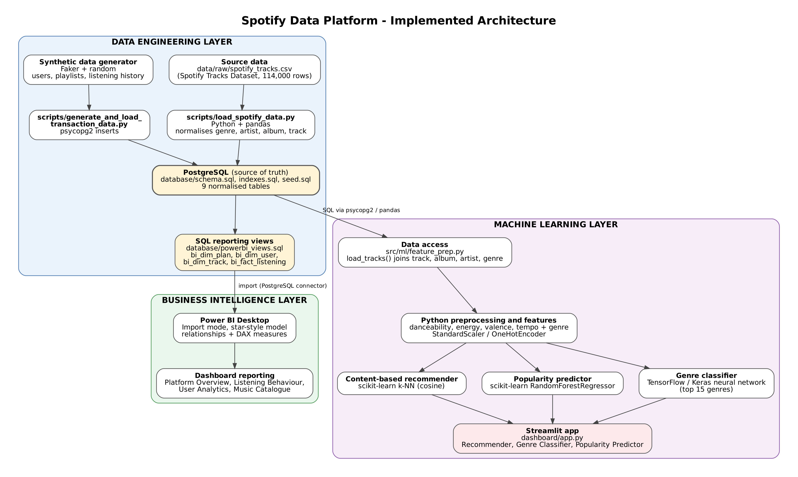

# System Architecture

The diagram shows only components that exist in the repository. PostgreSQL is the central database and source of truth;
the BI and ML layers both read from it and never write back.

## Layers

### Data Engineering layer
| Component | Location | Role |
|---|---|---|
| Source data | `data/raw/spotify_tracks.csv` | Public Spotify Tracks Dataset: 114,000 rows, 114 genres |
| Catalogue loader | `scripts/load_spotify_data.py` | Normalises the CSV into `genre`, `artist`, `album`, `track` |
| Synthetic data generator/loader | `scripts/generate_and_load_transaction_data.py` | Creates users, playlists, playlist tracks and listening history with Faker/`random` |
| PostgreSQL schema | `database/schema.sql`, `indexes.sql`, `seed.sql` | 9 normalised tables, constraints, indexes, plan seed data |
| Reporting views | `database/powerbi_views.sql` | Four `bi_*` views for Power BI |

Details: [ETL pipeline](etl_pipeline.md) · [Database design](database_design.md).

### Business Intelligence layer
PostgreSQL `bi_*` views → Power BI Desktop (import mode, one-to-many model, DAX measures) → four dashboard pages.
Details: [POWER_BI_DOCUMENTATION.md](POWER_BI_DOCUMENTATION.md).

### Machine Learning layer
`src/ml/feature_prep.py` reads the track catalogue from PostgreSQL; four audio features plus genre are prepared; three models are served through
`dashboard/app.py` (Streamlit): a scikit-learn k-NN recommender, a scikit-learn RandomForest popularity predictor and a
TensorFlow/Keras genre classifier. Details: [Machine learning](machine_learning.md).

## Design decisions
- **Separation of BI and ML.** BI needs flat, aggregate-friendly views; ML needs row-level features in Python. Each reads PostgreSQL through its own path.
- **Views as the BI contract.** Power BI depends on `bi_*` views, not on the transactional tables.
- **Trained artifacts are files.** The popularity model, genre classifier, scaler and label encoder are saved to `src/ml/artifacts/` and loaded by the app. The recommender is fitted when the app starts.

## Not part of the diagram (not in the repository)
The earlier Python analytics module (`src/analytics/`, referenced in comments and the old README) is not present in the project folder.
Its saved outputs are in `data/processed/`; these files should not be cited, because some of their play counts look inflated by a join between playlists and listening history.
