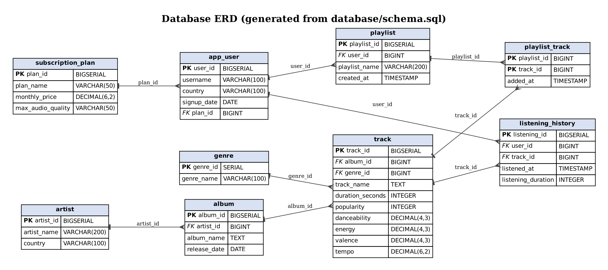

# Database Design

*ERD generated from [`database/schema.sql`](../database/schema.sql).*

## Tables
| Table | Purpose | Keys / notable constraints |
|---|---|---|
| `genre` | Genre lookup | PK `genre_id`; `genre_name` unique |
| `subscription_plan` | Plans (Free, Premium) | PK `plan_id`; `plan_name` unique |
| `artist` | Artists | PK `artist_id`; `artist_name` unique |
| `album` | Albums | PK `album_id`; FK `artist_id`; unique (`album_name`, `artist_id`) |
| `track` | Tracks and audio features | PK `track_id`; FKs `album_id`, `genre_id`; CHECKs: duration > 0, popularity 0–100, danceability/energy/valence 0–1, tempo > 0 |
| `app_user` | Users (synthetic) | PK `user_id`; `username` unique; FK `plan_id` |
| `playlist` | Playlists (synthetic) | PK `playlist_id`; FK `user_id` |
| `playlist_track` | Playlist ↔ track (many-to-many) | Composite PK (`playlist_id`, `track_id`); FKs to both |
| `listening_history` | One row per listen (synthetic) | PK `listening_id`; FKs `user_id`, `track_id`; `listening_duration` ≥ 0 |

## Relationships
`artist 1─* album 1─* track *─1 genre`; `subscription_plan 1─* app_user 1─* playlist *─* track` (via `playlist_track`);
`app_user 1─* listening_history *─1 track`.
Artists are reached from tracks through albums, so there is no direct `track → artist` key.

## Normalisation notes
- Artist, album and genre names are stored once and referenced by key (3NF-style).
- Only the first artist of a multi-artist track is attached to the track's album; other credited artists get their own `artist`/`album` rows but are not linked to the track.
- `track` stores four audio features (`danceability`, `energy`, `valence`, `tempo`). [`data_mapping.md`](data_mapping.md) documents additional dataset columns
  (acousticness, loudness, key, …) that the current schema and loader do **not** store.

## Indexes (`database/indexes.sql`)
Indexes on the foreign-key and date columns used by joins and time filters (`listening_history.user_id/track_id/listened_at`,
`track.genre_id/album_id`, `album.artist_id`, `app_user.plan_id/signup_date`, `playlist.user_id`, `playlist_track.track_id`).
Create them **after** loading data for faster inserts.

## Reporting views
Documented in [POWER_BI_DOCUMENTATION.md](POWER_BI_DOCUMENTATION.md#2-where-the-data-comes-from); defined in `database/powerbi_views.sql`.
